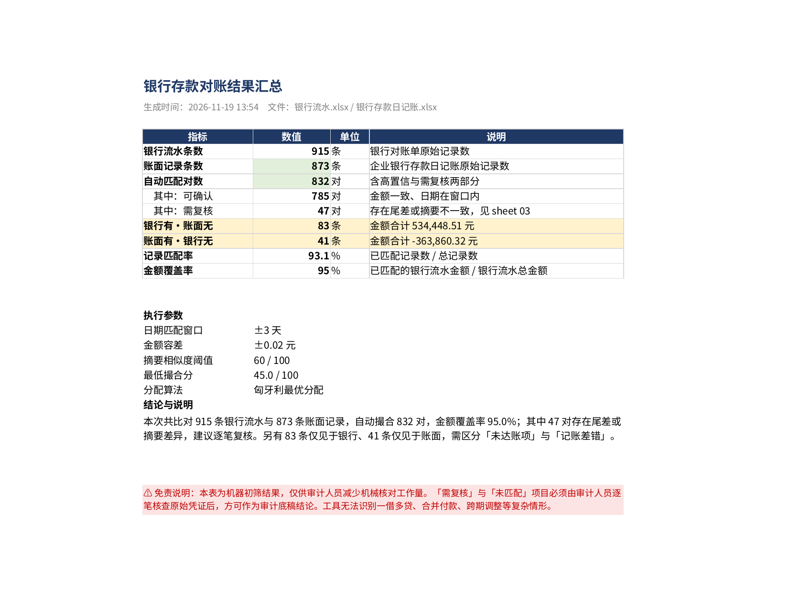
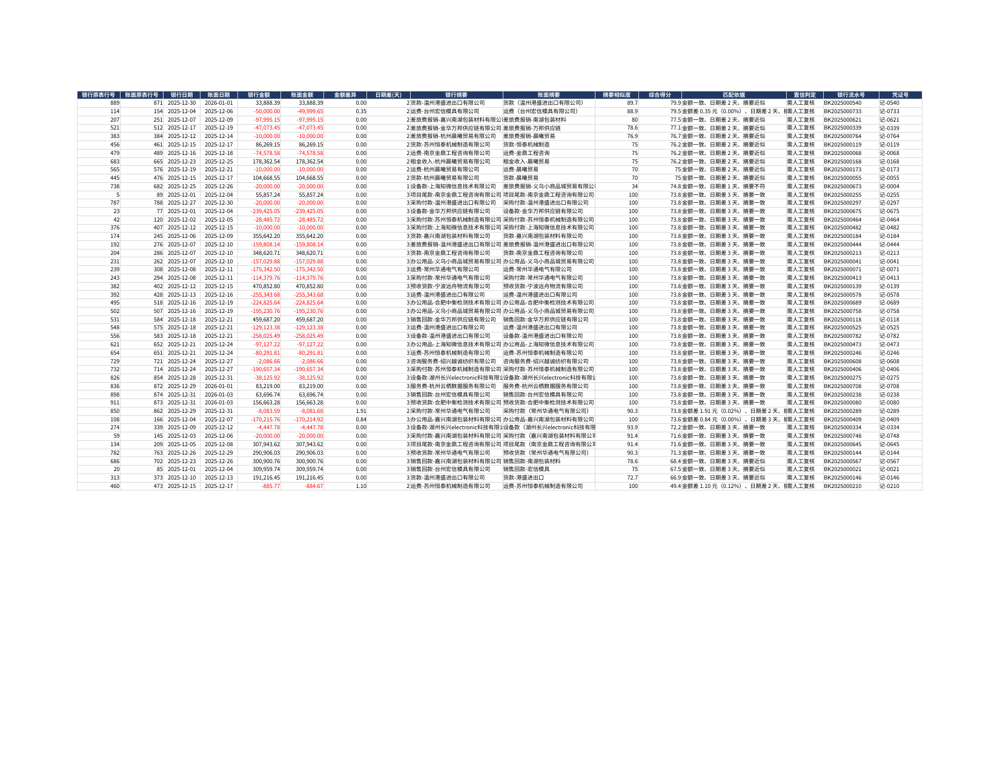
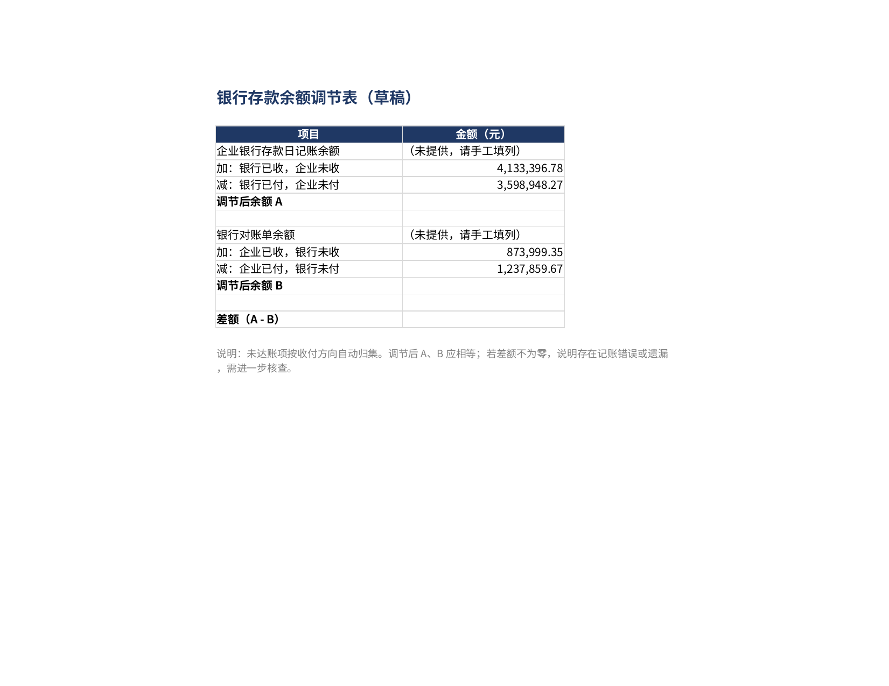

# 银行存款对账工具（bank-recon）

把银行对账单和企业银行存款日记账自动配成对，输出一份可以直接放进审计底稿的 Excel。

给审计现场做资金核查、银行函证时用：几千行流水手工比对，一晚上只能对几百条，而且对着对着就不知道哪笔漏了。



---

## 一、这个工具解决什么

审计做银行存款程序时，拿到两份表：

- **银行对账单**：银行给的流水，贷方是进账
- **企业银行存款日记账**：客户账上记的，借方是进账

两份表描述的是同一批业务，但几乎不会完全一样。常见的差异有四类：

| 差异类型 | 典型场景 | 手工怎么处理 |
| --- | --- | --- |
| 尾差 | 银行扣了手续费，客户按原始付款额入账 | 逐笔看金额，肉眼判断 |
| 时差 | 月末跨日入账，差 1~3 天 | 按日期窗口人工筛 |
| 摘要改写 | 「杭州晨曦贸易有限公司」记成「晨曦贸易」 | 靠记忆和印象 |
| 单向记录 | 未达账项、漏记、重复记账 | 两边各扫一遍找落单的 |

工具的活是把前两类 90% 的机械比对干掉，把第三类用模糊匹配捞回来，第四类单独列出来给人看。**判断仍然由人做**，工具只负责把候选摆到面前。

## 二、为什么不是 VLOOKUP

直接按金额 VLOOKUP 会踩三个坑：

1. **同金额多笔**：一个月里三笔 100,000 的付款，VLOOKUP 会把它们错配，而且看起来"配上了"
2. **摘要对不上**：客户记账时把公司名缩写、加后缀、换语序，精确匹配一律落空
3. **尾差**：差 0.35 元的两笔，精确匹配视为不同

所以这里做的是**带评分的三阶段匹配**，不是等值连接。

## 三、匹配逻辑

```
阶段 1  金额分到分相同   → 桶内匈牙利算法做一对一最优分配（金额40 + 日期35 + 摘要25 打分）
阶段 2  金额差 ≤ 0.02 元 → 同上，捞手续费尾差
阶段 3  金额差 ≤ 5% 且 摘要相似度 ≥ 60 → 捞摘要改写、跨期入账
```

几个刻意的设计：

- **不是贪心**：同一金额桶里用 `scipy.optimize.linear_sum_assignment` 求全局最优，而不是"谁先扫到谁配"。贪心在一对多同金额时必然出错。
- **金额按相对误差计分**：10 万差 1 元是手续费，应当高分；100 元差 1 元才可疑。用绝对容差评分会把正常尾差打成低分。
- **宁可漏配，不可乱配**：低于 `min_score`（默认 45 分）的候选直接放弃，退回"未匹配"让人工处理。把两笔无关交易撮合成一对，对底稿的伤害远大于多留几条待核对项。
- **每一对都写清理由**：输出里有一列「匹配依据」，例如 `金额差 0.35 元（0.00%）、日期差 2 天、摘要近似`，审计人员一眼就能判断该不该认。
- **保留原表行号**：每条结果都带银行/账面的原始行号，任何一对都能回溯到原表第几行。



## 四、快速开始

```bash
pip install -r requirements.txt

# 先生成一批模拟数据（虚构，可直接跑）
python sample_data/generate_sample.py

# 跑对账
python run.py --bank sample_data/银行流水.xlsx \
              --ledger sample_data/银行存款日记账.xlsx \
              --out output/对账结果.xlsx
```

输出：

```
银行 915 条 / 账面 873 条
匹配 832 对（可确认 785，需复核 47）
银行有账面无 83 条，账面有银行无 41 条
记录匹配率 93.1%，金额覆盖率 95.0%
耗时 0.96 秒
```

> 上面的数字来自随包的模拟数据（915 条流水 vs 873 条账簿，故意掺入了尾差、时差、摘要改写和未达账项）。真实客户数据请自行脱敏后使用。

### 参数

| 参数 | 默认 | 说明 |
| --- | --- | --- |
| `--bank` | 必填 | 银行对账单（xlsx / xls / csv） |
| `--ledger` | 必填 | 企业银行存款日记账（xlsx / xls / csv） |
| `--out` | `output/对账结果.xlsx` | 输出路径 |
| `--date-window` | 3 | 允许的日期差（天） |
| `--amount-tolerance` | 0.02 | 阶段 2 的金额容差（元） |
| `--summary-threshold` | 60 | 阶段 3 摘要相似度下限（0–100） |
| `--bank-balance` | 无 | 银行对账单期末余额，填了才会算调节表 |
| `--ledger-balance` | 无 | 企业日记账期末余额，同上 |

列名会自动识别（交易日期/记账日期、摘要/对方户名、收入金额/支出金额、借方发生额/贷方发生额……），不需要客户改成固定模板。

**注意「借方/贷方」在两个来源里含义相反**：银行对账单里贷方是进账，企业日记账里借方是进账。工具按 `source` 参数分别处理，这一点写错会导致整表方向反了。

## 五、输出的底稿

| Sheet | 内容 |
| --- | --- |
| `01_对账汇总` | 指标、执行参数、结论、免责说明 |
| `02_已匹配明细` | 高置信匹配（金额一致 + 日期在窗口内 + 摘要相符） |
| `03_待复核` | 有尾差或摘要不一致，带匹配依据与综合得分，逐笔人工判断 |
| `04_银行有账面无` | 银行已发生、企业未入账，区分未达账项与漏记 |
| `05_账面无银行有` | 企业已记、银行未见 |
| `06_未达账项调节表` | 按收付方向自动归集；提供两端余额时自动算调节后余额与差额 |



## 六、项目结构

```
bank-recon-tool/
├── run.py                  # 命令行入口
├── recon/
│   ├── loader.py           # 读取 + 列名识别 + 借贷方向归一化
│   ├── matcher.py          # 三阶段匹配引擎
│   └── report.py           # xlsx 底稿输出
├── sample_data/
│   └── generate_sample.py  # 模拟数据生成（含四类脏数据）
├── output/                 # 对账结果
└── screenshots/
```

## 七、已知局限

1. **不支持一对多**：一笔银行流水对应多张凭证（合并付款、拆分收款）目前会落到"未匹配"，需要人工合并后再跑。
2. **不支持外币折算**：外币账户要先换算成本位币再比对。
3. **不判断业务实质**：工具只看金额、日期、摘要三个维度。摘要只是线索，最终是否同一笔业务要凭原始凭证。
4. **摘要相似度对行业黑话不敏感**：如果客户内部有大量缩写代号，`--summary-threshold` 要调低，或者先维护一张映射表。

## 八、技术栈

Python 3.10+ / pandas / openpyxl / rapidfuzz（模糊匹配）/ scipy（匈牙利算法，缺失时自动降级为贪心）。

---

**数据说明**：仓库内所有数据均由 `sample_data/generate_sample.py` 随机生成，公司名称、人名、金额均为虚构，不包含任何真实客户信息。工具输出仅供辅助核对，不能替代审计人员的专业判断。
